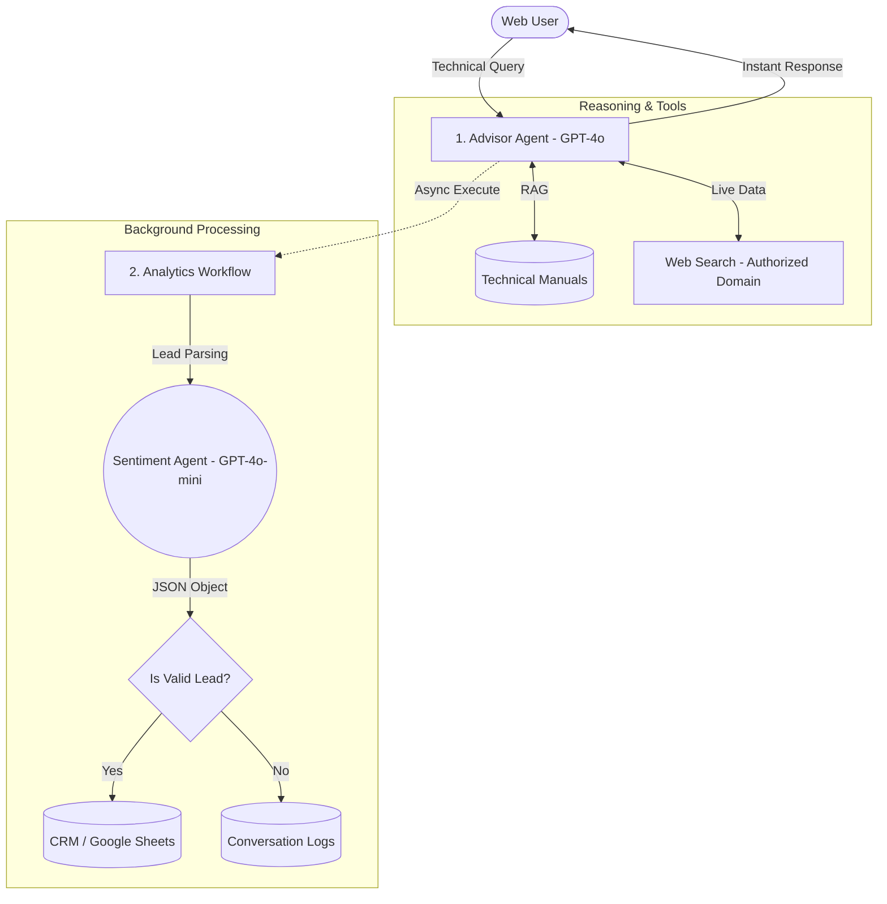

# 🤖 Expert AI Technical Advisor & Sales Automation System

> **Reference Architecture:** A sophisticated, multi-agent AI system designed for technical sales of complex industrial machinery. Features a high-fidelity RAG engine, automated engineering "sanity checks," and an asynchronous lead-capture pipeline.

---

## ⚠️ Disclaimer
This repository contains a sanitized reference implementation inspired by production systems architected for heavy machinery distributors. **All proprietary brand data, internal API credentials, and client-specific business logic have been removed.** This project demonstrates architectural patterns and prompt engineering for enterprise AI deployments.

---

## 💡 System Capabilities

This system acts as a **Virtual Technical Consultant** for complex, high-ticket equipment. It follows a "Diagnose before Propose" methodology, ensuring that recommendations are technically viable and compliant with engineering constraints.

### Core Features:
*   **Technical Diagnosis Engine:** The agent identifies customer requirements (capacity, power, operational scale) before searching the Vector Store for specific equipment models.
*   **Engineering "Sanity Check":** Built-in logic to prevent configuration errors (e.g., ensuring an attachment is compatible with the base machine's power output).
*   **Brand Exclusion Logic:** Intelligent query processing that filters out competitor mentions when searching the internal knowledge base for compatible solutions.
*   **Multi-Agent Lead Capture:** A dedicated "Sentiment Agent" parses conversation history in the background to extract lead data (Name, Phone, Intent) only when purchase signals are detected.
*   **Compliance Automation:** Automated insertion of mandatory legal disclaimers and data processing notices (GDPR) whenever personal information is requested.

---

## 🛠️ System Architecture

The system uses a **Decoupled "Fire-and-Forget" Architecture** to ensure zero latency for the end user.

### Logic Flow

---

## 📂 Repository Structure

*   **/workflows_sanitized/**
    *   `1_chat_advisor_frontend.json`: The core RAG-enabled agent with complex technical diagnosis logic and intent detection.
    *   `2_background_analytics.json`: The asynchronous "Fire-and-Forget" backend for lead extraction, sentiment analysis, and CRM synchronization.
    *   `3_automated_reporting.json`: A scheduled business intelligence (BI) workflow that generates weekly performance audits and lead quality summaries for management.
*   **/diagrams/**: Technical architecture diagrams and logic flow schematics (Mermaid & screenshots).
*   **/mock_data/**: Sanitized technical specifications (CSV/PDF) and sample lead log templates for testing.

---
---

## 🧠 Engineering Challenges & Solutions

### 1. Zero-Latency Asynchronous Analytics (The "Decoupling" Pattern)
**Problem:** Real-time sentiment analysis and lead data extraction traditionally add 5-10 seconds to the response time, significantly degrading the user experience.  
**Solution:** I implemented a **Decoupled Architecture** using n8n’s sub-workflow execution with the `waitForSubWorkflow: false` (Fire & Forget) configuration. The Advisor Agent responds to the user in under 3 seconds, while a background "Sentiment Agent" handles the complex data parsing and CRM logging independently.

### 2. Engineering Constraint Validation & Hallucination Control
**Problem:** Generic LLMs often agree to technically impossible configurations (e.g., suggesting a high-capacity attachment for a low-power base machine).  
**Solution:** Developed a **Strict Logic Layer** within the System Prompt. The agent is forced to perform a "Technical Sanity Check" by cross-referencing user requirements with the verified technical specs in the Vector Store. If a mismatch is detected, the agent is programmed to politely correct the user rather than providing a hallucinated solution.

### 3. Intent-Triggered Lead Conversion
**Problem:** Static "contact us" forms are often ignored, while aggressive bots asking for data too early increase bounce rates.  
**Solution:** Engineered a **Contextual Conversion Trigger**. The AI remains in "Advisory Mode" until it detects specific purchase intent signals (e.g., pricing inquiries, requests for financing, or compatibility questions). At that precise moment, the agent triggers a lead-capture module, providing a seamless transition from information gathering to a sales opportunity.

### 4. Background Data Structuring for Sales Prioritization
**Problem:** Raw chat logs are time-consuming for sales managers to review and audit.  
**Solution:** The background Analytics Workflow uses **JSON Output Parsing** to distill entire conversations into four actionable fields: `sentiment` (HOT/COLD), `phone`, `name`, and `interest`. This allows for automated lead scoring and ensures that the sales team prioritizes the highest-value inquiries first.

---

## 🤝 Transparency: Human vs. AI Role

This project was built using an **AI-Augmented Systems Engineering** approach, focusing on high-level architecture and precise prompt engineering.

*   **MarTech Architect (Me):** Designed the multi-workflow async logic, defined the agrotechnical/technical constraint rules, and engineered the conversion strategy. Configured the VPS environment, Docker containers, and RAG (Vector Store) hierarchy.
*   **AI Role:** Assisted in generating specific JavaScript snippets for JSON data transformation and provided troubleshooting support for API-specific error handling (e.g., handling rate limits and token optimization).

---

## 🚀 Deployment Requirements

*   **Orchestrator:** n8n (Self-hosted on Docker)
*   **Inference Engine:** OpenAI GPT-4o (Advisor) & GPT-4o-mini (Analytics)
*   **Knowledge Base:** OpenAI File Search (RAG)
*   **Data Destination:** Google Sheets API (as a Lightweight CRM)
*   **External Search:** Authorized Web Search Tool (for dynamic updates)
