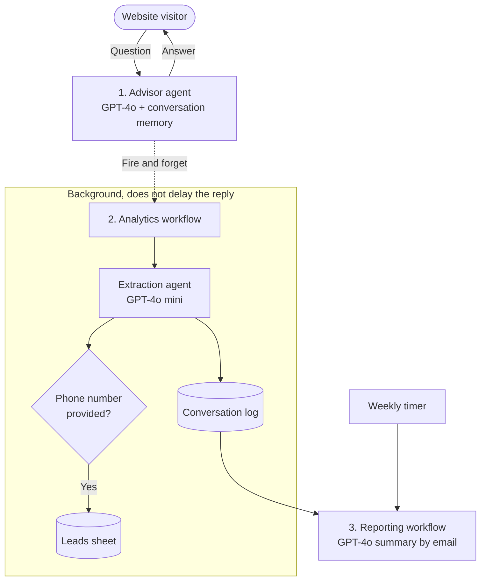

# AI Technical Sales Advisor

A chat advisor for a heavy machinery distributor that asks about the customer's needs before recommending a model, answers from technical documentation, and passes leads to sales in the background without slowing the conversation.

-red)

> [!NOTE]
> This repository is a sanitized reference implementation of a system I designed for machinery distributors. Brand data, credentials and client-specific logic are removed. The workflows here are a simplified version of the production setup; see [What's in this repository](#whats-in-this-repository) for exactly what is included.

## The problem

Buying industrial equipment is a technical decision. A customer asking about an attachment needs to know whether it fits their base machine's power and capacity, and the answer is buried in PDF manuals and spec sheets. Sales advisors spend their time answering the same questions, and website visitors who come outside office hours get nothing.

A generic chatbot makes this worse. It will happily confirm a configuration that cannot work, and it either asks for a phone number too early, which drives people away, or never asks at all.

## The solution

Three n8n workflows split the work between answering the customer and capturing the lead.

**1. Advisor.** The agent's prompt follows a fixed order: diagnose first (ask about requirements and use), then look up specs in the knowledge base, then recommend specific models with links. If the documentation doesn't cover something, it says so and suggests contacting a person instead of guessing. When a visitor shows buying intent, for example asking about price or financing, it asks for a name and phone number and includes the privacy notice.

**2. Analytics, in the background.** After every reply the advisor starts the analytics workflow with `waitForSubWorkflow: false`, so the visitor gets the answer without waiting for analysis. A second agent reads the conversation and returns JSON with `sentiment` (HOT LEAD / COLD LEAD / SUPPORT / SPAM), `name`, `phone` and `interest`. Every exchange goes to a conversation log; conversations with a phone number also go to the leads sheet.

**3. Weekly report.** A scheduled workflow takes the last 7 days of logs and has GPT-4o write an HTML report: number of conversations, top questions, questions the bot couldn't answer, high-intent leads, and suggested fixes to the knowledge base or prompt. The report goes to the sales manager by email.

## Key decisions

**Separate answering from analysis.** Extracting lead data in the same request as the answer would add several seconds to every reply. Running it as a detached sub-workflow keeps the chat responsive, and a failure in analytics can't break the conversation.

**Diagnose before recommending.** The prompt forbids proposing a model until the agent knows the requirements. The aim is fewer wrong recommendations that a sales advisor would later have to correct.

**Ask for contact details only after a buying signal.** The advisor stays in advisory mode until the visitor asks about price, financing or availability. That is the moment when asking for a phone number feels like help instead of a form.

**Spreadsheets as a lightweight CRM.** For the size of the client, Google Sheets was enough and let the sales team use the data from day one without new software.

## What's in this repository

| Part | In this repo | Production system |
|---|---|---|
| Advisor agent with diagnose → retrieve → recommend prompt | Yes | Yes |
| Conversation memory | Yes | Yes |
| Async lead extraction to Google Sheets | Yes | Yes |
| Weekly AI summary by email | Yes | Yes |
| Knowledge base (OpenAI File Search, vector store) | Referenced in the prompt, tool not attached | Yes |
| Web search fallback agent | No | Yes |
| Separate GDPR agent inserting a localized privacy notice | No (one instruction in the prompt) | Yes |
| Language detection for 9 languages (PL, EN, UK, DE, FR, ES, IT, LT, CS) | No | Yes |
| Prompt-injection and instruction-leak filters | No | Yes |
| Compatibility check against base machine specs, competitor-brand filtering | No | Yes |

## Results

The advisor answers technical questions at any hour, and the sales team gets a sheet of conversations with a phone number and the product of interest instead of reading raw chat logs. I don't have measured response times or conversion figures from the deployment, so none are claimed here.

## Who did what

I designed and directed the project. AI tools wrote most of the code.

- **Me:** designed the workflow architecture and the async pattern, wrote the rules the advisor follows (diagnosis first, compatibility checks, competitor filtering, when to ask for data), designed the GDPR and language handling, set up the VPS, Docker and the knowledge base structure.
- **AI:** wrote JavaScript for JSON transformation and date filtering, helped debug API errors and rate limits, and drafted the HTML email template for reports.

## Quick start

1. In n8n, import the workflows with **Workflows → Import from file**, starting with `2_analytics_backend_async.json`.
2. Copy the ID of the imported backend workflow into the `Async Analytics Trigger` node of `1_chat_frontend_logic.json`, replacing `YOUR_BACKEND_WORKFLOW_ID`.
3. Replace `YOUR_GOOGLE_SHEET_ID` in the Google Sheets nodes (backend and reporting). The backend writes to a conversation log (`SessionID`, `Date`, `User Query`, `Bot Response`, `Sentiment`, `Execution ID`) and a leads sheet (`Name`, `Phone`, `Interest`, `Sentiment`). `mock_data/` has sample rows.
4. Add OpenAI and Google credentials, and replace `manager@example.com` in `3_automated_reporting.json` with the real recipient.
5. To answer from your own documents, attach a vector store tool to the `AI Sales Agent` node and replace `[INSERT_COMPANY_NAME]` in its system prompt.

## Requirements

- n8n, self-hosted on Docker
- OpenAI API (GPT-4o, GPT-4o mini)
- Google Sheets and Gmail APIs

## Repository structure

| Path | Contents |
|---|---|
| `workflows_sanitized/1_chat_frontend_logic.json` | Chat trigger, advisor agent, memory, async trigger |
| `workflows_sanitized/2_analytics_backend_async.json` | Lead extraction agent, qualification check, Google Sheets logging |
| `workflows_sanitized/3_automated_reporting.json` | Weekly log summary sent by Gmail |
| `diagrams/` | Screenshots of the three workflows |
| `mock_data/` | Sample product catalog, chat logs and leads sheet (CSV) |
