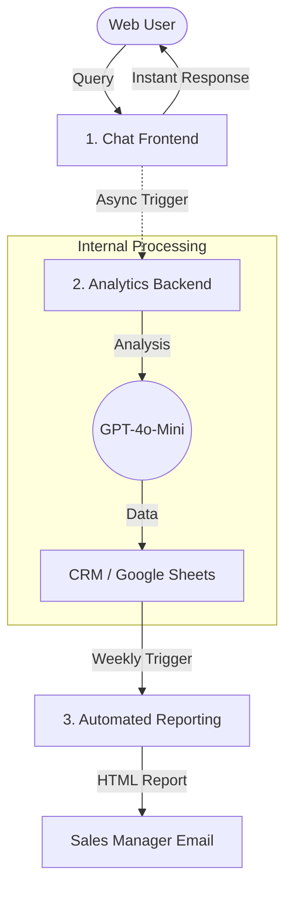

# 🤖 Expert AI Sales Advisor & Analytics System (Reference Architecture)

> A production-grade RAG (Retrieval-Augmented Generation) architecture designed for high-ticket sales. Features a decoupled frontend/backend design for low latency and automated business intelligence reporting.

---

## ⚠️ Disclaimer

This repository contains a sanitized reference implementation inspired by real-world production systems I have architected. No proprietary data, specific business logic, internal API credentials, or client-specific configurations are included. This project demonstrates the architectural patterns used to solve complex business problems using Low-Code and Generative AI.

---

## 💡 Project Overview

This system is a multi-tier AI solution designed to act as a 24/7 Virtual Sales Advisor. It doesn't just answer questions; it qualifies leads, tracks customer sentiment in real-time, and provides management with weekly automated performance audits.

### Key Components:

*   **High-Performance Chat Interface:** Optimized for speed (<3s response time) using a decoupled architecture.
*   **Asynchronous Analytics:** A "Fire-and-Forget" backend that processes logs and extracts CRM data without slowing down the user experience.
*   **Automated Reporting:** An AI-driven analyst that audits weekly logs and sends HTML reports to stakeholders.

---

## 🛠️ System Architecture

The system utilizes a **Decoupled Logic Pattern** built on **n8n** (Self-hosted via Docker).

### Logic Flow

---

## 📂 Repository Structure

*   **/workflows_sanitized/**
    *   `1_chat_frontend_logic.json`: The core chat engine with RAG capabilities and session memory.
    *   `2_analytics_backend_async.json`: Background processor for sentiment analysis and CRM logging.
    *   `3_automated_reporting.json`: Weekly scheduled task that generates business insights from logs.
*   **/diagrams/**: Visual representations of the workflow logic (screenshots).
*   **/mock_data/**: Templates for technical product data.

---

## 🧠 Engineering Challenges & Solutions

### 1. Latency Optimization (The "Decoupling" Strategy)

**Problem:** Performing sentiment analysis and CRM logging during the chat caused a 10-15 second delay, leading to poor user experience.  
**Solution:** I implemented an asynchronous **"Async Trigger"**. The Frontend workflow delivers the AI answer immediately and then triggers the Backend workflow to handle the "heavy lifting" (logging/parsing) independently.

### 2. Hallucination Control in Technical Sales

**Problem:** The AI suggested incorrect specifications for industrial machinery.  
**Solution:** Implemented a strict **System Prompt Hierarchy**. The model is forced to prioritize the "File Search" (Vector Store) over its general knowledge and is programmatically instructed to admit uncertainty rather than guessing.

### 3. Real-Time Lead Qualification & GDPR Compliance
**Problem:** Manual lead qualification is slow, and capturing data without proper legal consent poses a compliance risk.  
**Solution:** Engineered an autonomous qualification logic where the AI detects "buying signals" in real-time. Upon identifying high-intent users, the agent contextually requests their name and phone number while providing mandatory GDPR/RODO disclosures. Captured leads are instantly synchronized with a Google Sheets CRM for immediate sales follow-up.

### 4. Automated Performance Audits & BI
**Problem:** Managers had no time to read thousands of chat logs to find "Hot Leads" or identify knowledge gaps.  
**Solution:** Developed a weekly reporting workflow that uses **GPT-4o** to scan all logs, identify common customer pain points, and highlight high-intent leads in a clean, professional HTML email summary sent directly to stakeholders.

---

## 🤝 Transparency: Human vs. AI Role

*   **My Role (Architect):** Designed the multi-workflow architecture, defined the RAG strategy, engineered the prompt logic, and handled the DevOps setup (VPS, Docker, SSL).
*   **AI Role (Assistant):** Assisted in writing specific JavaScript snippets for data formatting and provided debugging support for API error handling.

---

## 🚀 Deployment Requirements

*   **Orchestrator:** n8n (Self-hosted on Docker)
*   **LLM:** OpenAI API (GPT-4o and GPT-4o-mini)
*   **Storage:** Google Sheets API (as a lightweight CRM)
*   **Email:** Gmail/SMTP for reporting
